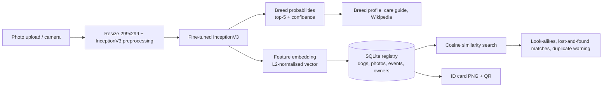

# 🐾 DogID: AI-Powered Digital Dog Identity

**DogID** is an end-to-end machine learning application built on a deep-learning breed classifier. A transfer-learning model (InceptionV3, trained on the Stanford Dogs dataset) recognises **120 dog breeds**, and a full-stack Streamlit app turns that model into a product: breed intelligence, a dog registry with digital profiles and ID cards, photo-based matching of lost and found dogs, and a lifestyle-based breed recommender.

> **In one sentence:** upload a photo, learn the breed and its needs, register your dog to get a digital identity card, and find potentially matching dogs in a registry.

---

## Table of Contents

1. [Why this project](#why-this-project)
2. [Feature overview](#feature-overview)
3. [How it works](#how-it-works)
4. [Tech stack](#tech-stack)
5. [Project structure](#project-structure)
6. [Getting started](#getting-started)
7. [Using the app](#using-the-app)
8. [The model](#the-model)
9. [Design decisions and honest limitations](#design-decisions-and-honest-limitations)
10. [Privacy and security](#privacy-and-security)
11. [Roadmap](#roadmap)
12. [Dataset and credits](#dataset-and-credits)
13. [Author](#author)

---

## Why this project

Most breed-classifier projects stop at a notebook that prints a label. This project goes further and shows the full path from **model → product**:

- a trained CNN served efficiently inside a web app (model and predictions cached for speed),
- a second use of the same network (its internal features) for **photo similarity search**,
- a persistent **database-backed registry** with ownership history and access control,
- rule-based **recommendation and scoring engines**,
- a custom-designed, responsive, light/dark **UI** built from a small design system.

## Feature overview

| Area | What it does |
|---|---|
| **AI breed identification** | Upload or capture a photo and predict one of 120 breeds, with the top-5 alternatives. |
| **Confidence analysis** | Animated confidence ring plus a verdict (high, moderate or low confidence) and alternative breeds as bars. |
| **Breed intelligence** | Size, weight, lifespan, temperament, and 1-5 scores for energy, grooming, trainability, kid-friendliness and apartment suitability, plus a Wikipedia summary. |
| **Care recommendations** | Daily exercise time, grooming frequency, feeding range and breed-specific tips, generated from the breed's traits. |
| **Dog registration** | Register an individual dog with name, breed, sex, birth date, colour, optional microchip number, owner details and up to 5 photos. |
| **Digital dog profile** | Photo gallery, age, breed traits, status (Registered, Lost or Found) and notes in one profile. |
| **Ownership and history tracking** | Every event (registration, photos added, status changes, ownership transfers) is logged on a timeline, with a full list of past and current owners. |
| **Shareable ID card** | Generates a downloadable PNG identity card with photo, ID, breed and QR code. Contact details are never printed on the card. |
| **Photo comparison** | Compare a new photo against every registered dog using deep-feature similarity. |
| **Find potentially matching dogs** | A "Find a dog" search ranks the closest registered dogs, highlights lost dogs, and shows the owner's contact only for dogs marked Lost. A "Look-alikes" view on each profile lists similar dogs, and registration warns about near-duplicates. |
| **Lifestyle compatibility engine** | Answer questions about home, yard, children, exercise time, grooming tolerance and experience, and get the top 5 breeds with a 0-100 compatibility score and a breakdown. |
| **Breed comparison** | Compare 2 to 4 breeds side by side. |
| **UI/UX** | Custom CSS design system, in-app light/dark switch, responsive layout and keyboard-visible focus states. |

## How it works



One forward pass through the network yields **both** outputs: the breed prediction (final softmax layer) and an embedding (the layer before it). The embedding is stored with each registered photo, and new photos are compared by **cosine similarity** against the best-matching photo of every registered dog.

### Lifestyle compatibility score

Each curated breed is scored from 0 to 100 as a weighted average of five components:

| Component | Based on |
|---|---|
| Activity match | Your daily exercise hours mapped to an ideal energy level, versus the breed's energy |
| Home fit | Apartment suitability, or yard availability for house owners |
| Family fit | Kid-friendliness (weighted more heavily when you have children) |
| Low upkeep | Grooming needs, weighted by how much you prefer low-maintenance dogs |
| Easy to train | Trainability, weighted by your dog-owning experience |

## Tech stack

- **ML:** TensorFlow / Keras, InceptionV3 transfer learning, NumPy, scikit-learn (training and evaluation)
- **App:** Streamlit with custom CSS and HTML components, Pillow
- **Data:** SQLite (standard library) for the registry, local file storage for photos
- **Integrations:** Wikipedia API for breed summaries, `qrcode` for ID-card QR codes
- **Security:** PBKDF2-HMAC-SHA256 salted PIN hashing

## Project structure

```
.
├── app.py                  # Streamlit app: pages, layout and user flows
├── engine.py               # Model loading, inference + embeddings, Wikipedia, care plans, compatibility scoring
├── registry.py             # SQLite registry: dogs, photos, events, owners, PIN auth, similarity search
├── idcard.py               # Digital ID card (PNG) generator
├── data.py                 # Curated breed knowledge base and helpers
├── ui.py                   # Theme tokens, CSS loader, HTML components (rings, meters, bars, timeline)
├── assets/
│   └── style.css           # Custom design system (light/dark, responsive)
├── .streamlit/
│   └── config.toml         # Streamlit configuration
├── Stanford_Dog_Breeds_Classification.ipynb   # Model training notebook
├── dog_breed_classifier_model_via_inceptionv3.h5   # Trained model (required to run the app)
├── Images/                 # Stanford Dogs folders (e.g. n02099601-golden_retriever); used for breed labels
├── registry/               # Created at first run: dogid.db and photos/
└── requirements.txt
```

## Getting started

### Prerequisites

- Python 3.9+
- The trained model file `dog_breed_classifier_model_via_inceptionv3.h5` in the project root
- The `Images/` folder from the Stanford Dogs dataset in the project root (only the folder names are used, to recover the 120 breed labels in the same order as training)

### Install and run

```bash
git clone <your-repo-url>
cd <your-repo-folder>

python -m venv .venv
# Windows: .venv\Scripts\activate    macOS/Linux: source .venv/bin/activate

pip install -r requirements.txt
streamlit run app.py
```

Then open the local URL Streamlit prints (usually http://localhost:8501).

### Requirements

```
streamlit>=1.40
tensorflow>=2.15
pillow
numpy
wikipedia
qrcode[pil]
```

(`pandas`, `scikit-learn` and `matplotlib` are needed only to run the training notebook.)

### Retraining the model

Open `Stanford_Dog_Breeds_Classification.ipynb`, point the dataset path at your copy of the Stanford Dogs dataset, and run the cells in order. Save the result as `dog_breed_classifier_model_via_inceptionv3.h5`.

## Using the app

1. **Identify:** upload or capture a dog photo. See the breed, confidence, alternatives, traits, care guide and a Wikipedia summary.
2. **Register:** create a digital identity. Your photo and predicted breed are pre-filled. Choose an owner PIN.
3. **Registry:** open any dog to see its profile, download its **ID card**, review its **history and ownership**, and see **look-alikes**. Use the *Manage* tab (PIN required) to add photos, mark a dog Lost or Found, or transfer ownership.
4. **Find a dog:** upload a photo of a dog you found and see the closest registered matches.
5. **Lifestyle:** answer a few questions and get ranked breed recommendations with compatibility scores.
6. **Compare:** put 2 to 4 breeds side by side.

## The model

| Item | Detail |
|---|---|
| Architecture | InceptionV3 (ImageNet weights) as feature extractor + custom classification head |
| Task | 120-class classification on the Stanford Dogs dataset (about 20,000 images) |
| Input | 299 × 299 RGB, InceptionV3 preprocessing |
| Training | Data augmentation, train/validation/test split, one-hot labels |
| Result | About **90% accuracy** on the held-out test set |

The notebook covers data loading, shuffling and visualisation, optional subsetting, label encoding, train/validation/test splits, augmentation, model building, training, accuracy and loss plots, test-set evaluation (accuracy, precision, recall, F1) and prediction-versus-actual visualisations.

## Design decisions and honest limitations

- **Photo matching measures visual resemblance, not identity.** The network was trained to separate *breeds*, not individual dogs, so two dogs of the same breed can look very similar to it. The similarity bands (`SIM_HIGH = 0.90`, `SIM_MID = 0.80` in `engine.py`) are starting points and should be calibrated on real registry data. Matches are meant to surface candidates for a human to confirm (microchip scan, owner contact). A natural upgrade is a model trained with metric learning on individual dogs.
- **Breed intelligence is curated for 30+ popular breeds.** Other breeds show neutral estimates, clearly flagged in the UI, plus their Wikipedia summary. The lifestyle recommender scores only curated breeds.
- **Pure-breed bias.** The classifier knows 120 pure breeds, so mixed breeds may score lower or be matched to their closest-looking breed.
- **Single-instance registry.** Data lives in a local SQLite file, with access control by a per-dog PIN rather than user accounts.
- **Care guidance is general information, not veterinary advice.**

## Privacy and security

- ID cards never include contact details; owner names are optional and off by default.
- An owner's contact is shown publicly **only** while the dog is marked **Lost**.
- Owner PINs are never stored in plain text. They are salted and hashed with PBKDF2-HMAC-SHA256 (100,000 iterations) and compared in constant time.
- Photo, status and ownership changes require the PIN, and every change is recorded in the history log.

## Roadmap

- User accounts with proper authentication and per-owner dashboards
- Metric-learning model for true individual-dog re-identification
- Approximate nearest-neighbour index for large registries
- Editable profiles and vaccination or health records
- Curated profiles for all 120 breeds
- Docker image and cloud deployment with managed storage

## Dataset and credits

- **Stanford Dogs Dataset:** Khosla et al., *Novel Dataset for Fine-Grained Image Categorization*, CVPR Workshop on Fine-Grained Visual Categorization, 2011. http://vision.stanford.edu/aditya86/ImageNetDogs/
- **InceptionV3:** Szegedy et al., *Rethinking the Inception Architecture for Computer Vision*, 2016.
- Breed summaries are fetched from Wikipedia.

## Author

**Birhan Tamiru**: built the model, the application and the design system.